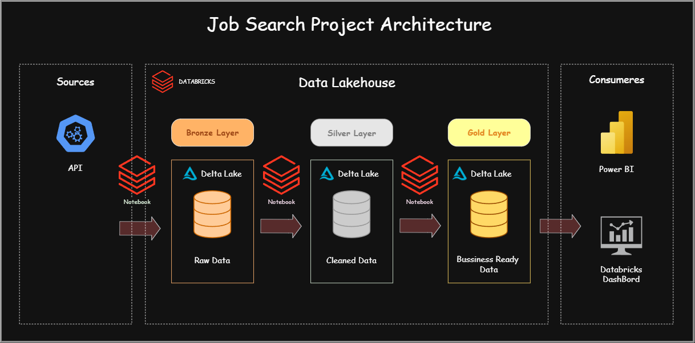
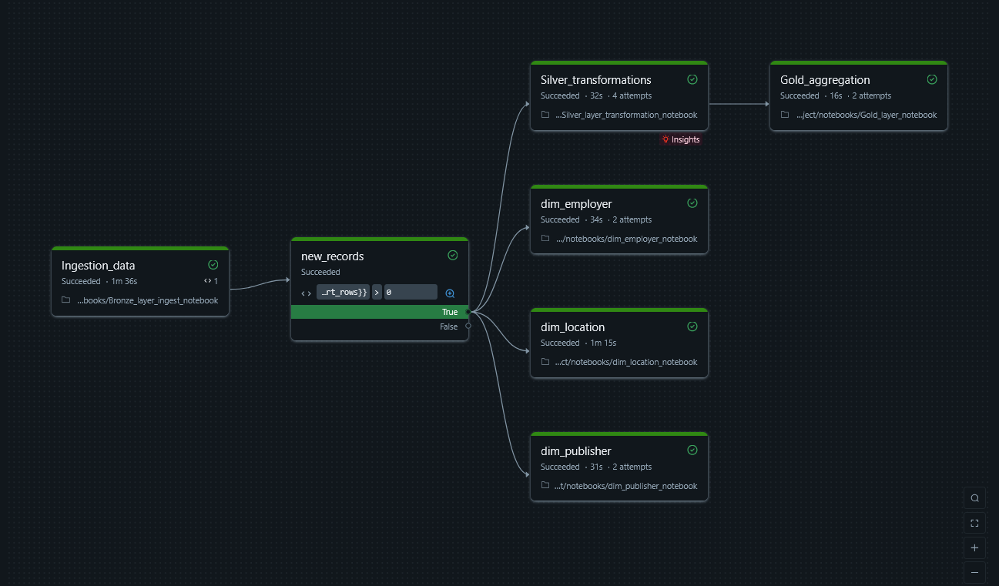

# Job Market Pipeline

## Overview

Job Market Pipeline is an end-to-end data engineering project. It collects job postings from a Job Search API, transforms them with Databricks and PySpark, stores the results in Delta Lake, and produces analytics-ready datasets.

The project covers a real-world workflow: API ingestion, ETL, data modeling, and analytics.

## Architecture

The pipeline follows a medallion architecture on Databricks. Raw job-posting data moves through the Bronze, Silver, and Gold layers and ends up as clean, business-ready datasets. The diagram shows the full flow, from API ingestion to analytics and visualization.



## Technologies

| Technology | Purpose                     |
| ---------- | --------------------------- |
| Databricks | Data processing platform    |
| PySpark    | Data transformation         |
| Python     | API ingestion and utilities |
| REST API   | Job data source             |
| Delta Lake | Data storage                |
| SQL        | Analytics queries           |
| GitHub     | Version control             |
| Power BI   | Data visualization          |

## Project structure

```
Job_Market_Pipeline-Databricks-Pyspark/

|
├── dashbord/
│   ├── data_model.png
|   ├── View offres.png
|   └── View synthese.png
│
├── docs/
│   └── architecture.png
|
├── notebooks/
|   ├── ingest_api_bronze_layer.ipynb
|   ├── clean_transform_data_silver_layer.ipynb
|   ├── analytics_golds_layer.ipynb
|   ├── dim_employer_notebook.ipynb
|   ├── dim_location_notebook.ipynb
|   └── dim_publisher_notebook.ipynb
|   
|── src/
|    ├── defintion_tables/
|    |   ├── def_bronze_table.sql
|    |   ├── def_silver_table.sql
|    |   ├── def_gold_table.sql
|    |   ├── dim_job_employer_table.sql
|    |   ├── dim_job_location_table.sql
|    |   └── dim_job_publisher_table.sql
|    |   
|    |── sql/
|    |   ├── top_employers.sql
|    |   ├── top_regions_per_offres.sql
|    |   └── top_skills.sql
|    |
|    |── test/
|    |   ├── integration/
|    |   |   └── integration_test.py
|    |   └── unit/
|    |       └── cleaning_processing_test.py
|    |
|    ├── transformations/
|    │   ├── gold_transformationss.ipynb
|    │   ├── ingestion_transformations.ipynb
|    │   └── silver_transformations.ipynb
|    |
|    └── utils/
|        ├── api_response.py
|        ├── config.py
|        ├── geo_location.py
|        └── spark_utils.py
|
├── .gitignore
├── databricks.yaml
├── requirements.txt
└── README.md
```

## Data pipeline

### 1. Bronze layer: ingestion

The ingestion step pulls job postings from a [REST API](https://rapidapi.com/letscrape-6bRBa3QguO5/api/jsearch/playground/endpoint_23a56c32-02d3-45a2-94ab-fdda973f445c). Each posting includes the job title, company, location, description, posting date, and other fields. Raw responses are stored unmodified, so the original data stays available.

### 2. Silver layer: cleaning

The cleaning step applies these rules:

* Remove duplicate job postings
* Handle missing values
* Normalize locations
* Standardize job titles
* Convert dates

The output is a structured Delta table ready for analysis.

### 3. Gold layer: analytics

The Gold layer organizes business-ready data in a star schema for analytical queries and reporting. Fact tables hold measurable events and metrics, such as job postings and salary information. Dimension tables hold descriptive attributes: company, location, job title, publisher, and date.

The queries in `src/sql` answer questions such as:

* Which companies hire the most?
* Which regions hire the most?
* Which skills are required most often?
* How does job demand change over time?

## Setup

### 1. Clone the repository

```bash
git clone https://github.com/oussama-elmaachy/Job_Market_Pipeline-Databricks-Pyspark
```

### 2. Install dependencies

```bash
pip install -r requirements.txt
```

### 3. Configure API credentials

The API key is read from Databricks Secrets and never stored in the code:

```python
api_key = dbutils.secrets.get(
    scope="job-search-api",
    key="api-key"
)
```

### 4. Run the pipeline

Execute the notebooks in the order shown below:



## Data quality checks

The pipeline validates:

* Missing values
* Duplicated records
* Required columns
* API response structure
* Data types

## Future improvements

* Add CI/CD with GitHub Actions
* Add integration tests 
* Add a data quality framework (Great Expectations)

## Author

Oussama EL MAACHY, Data & Analytics Engineering portfolio project.

GitHub: https://github.com/oussama-elmaachy
LinkedIn: https://linkedin.com/in/oussama-elmaachy

## License

This project is for educational and portfolio purposes.
